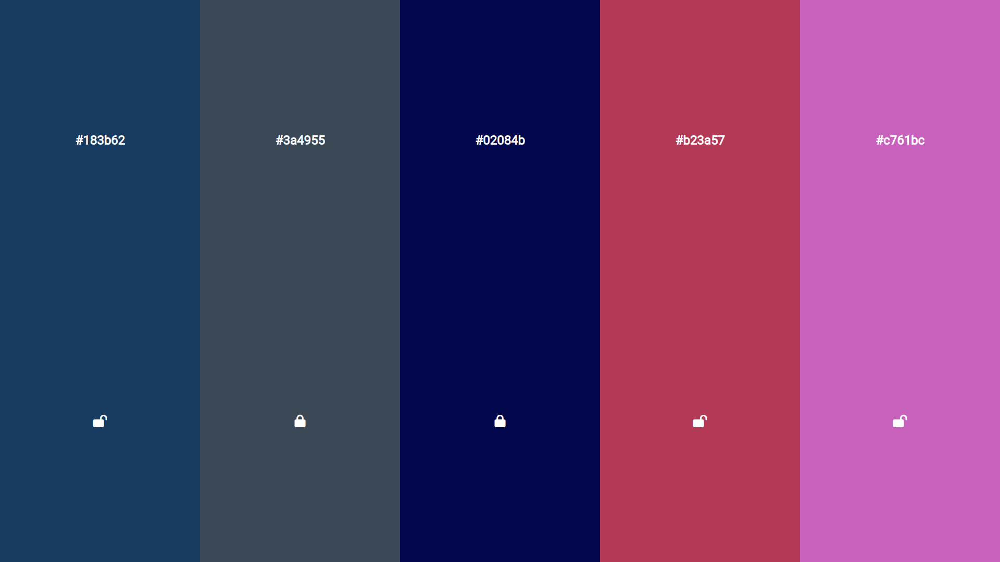

# vladilenMinin

**Credits & acknowledgments**

This project was coded line-by-line for practice and learning purposes, following the tutorial by [Vladilen Minin](https://www.youtube.com/@VladilenMinin).

## colors

- **Tutorial video:** [YouTube](https://www.youtube.com/watch?v=OaNICHKM5KM&list=PLgZLkhmkUbsW-SlAbSFAiqSnmpbmDNpD7&index=4)

